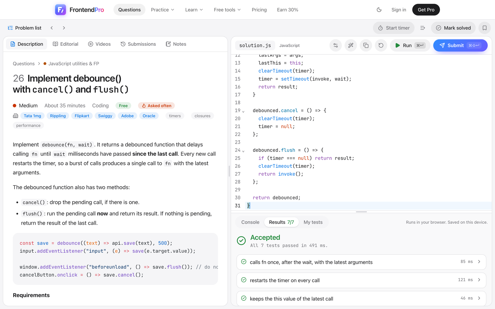
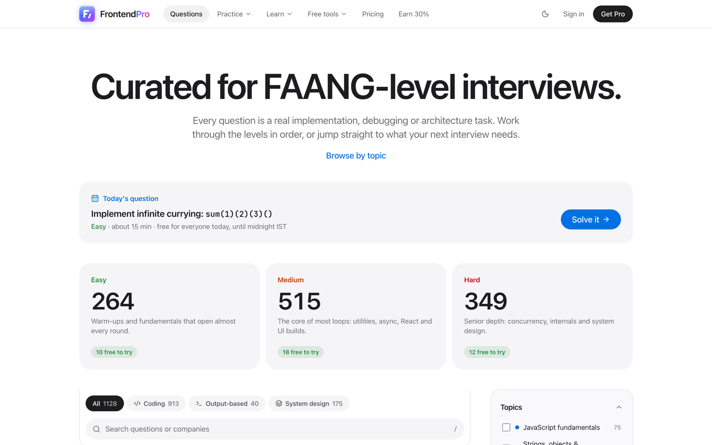
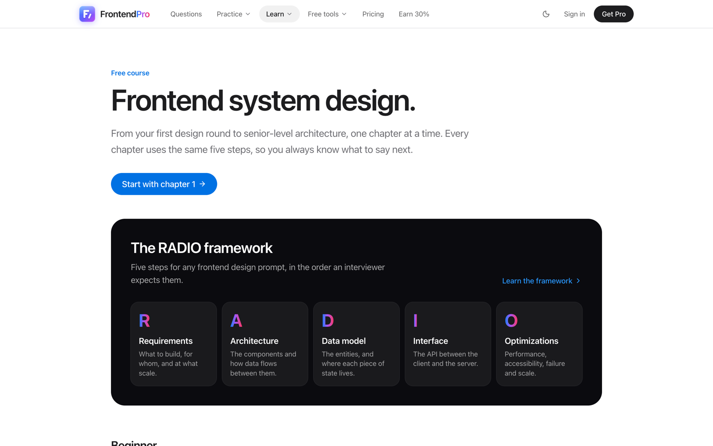
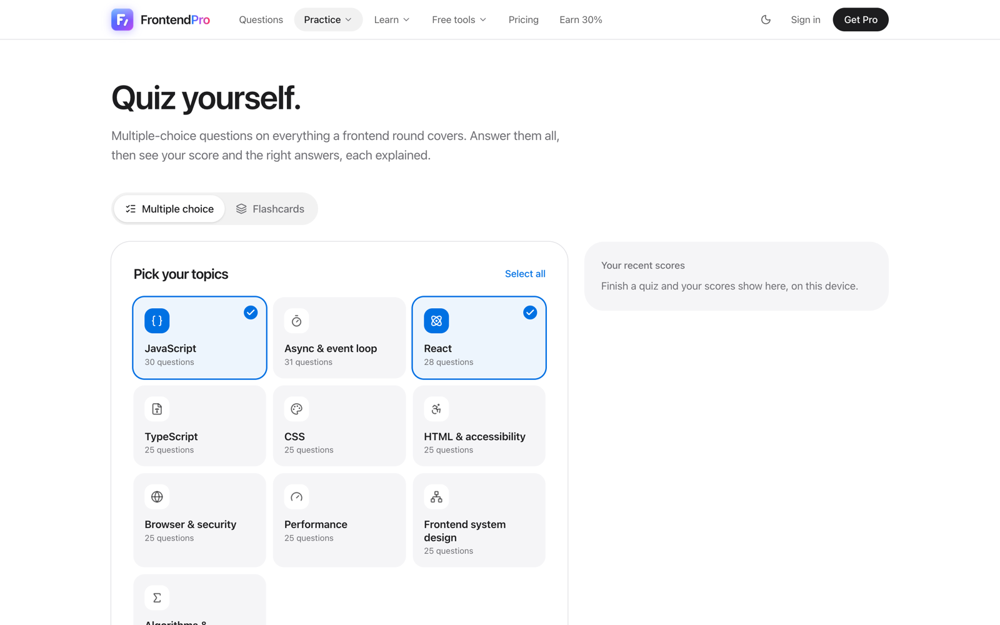

# UIRound: frontend interview prep

[UIRound](https://frontend.nextjoblist.com) is a place to practise frontend interviews the way they actually happen: write the code in a browser editor, run real tests against it, then read a step-by-step answer and the follow-up questions an interviewer would ask next.

This repository is the public home of the site. It has the free questions you can read here and solve on the site, a tour of everything the site does, and the place to **report bugs and ask for features**.

## What you can do on the site

- **Solve questions in a real editor.** JavaScript, React and TypeScript run in the browser with tests, so you know when your answer works. Try the [JavaScript editor](https://frontend.nextjoblist.com/javascript-editor) or the [React editor](https://frontend.nextjoblist.com/react-editor).
- **Practise UI questions in React, Vue, Angular or Svelte.** Machine coding questions come with a version for each framework: [Vue](https://frontend.nextjoblist.com/interview-questions/vue), [Angular](https://frontend.nextjoblist.com/interview-questions/angular), [Svelte](https://frontend.nextjoblist.com/interview-questions/svelte).
- **Solve TypeScript type challenges.** Type-level questions are checked by the TypeScript compiler as you type: [TypeScript questions](https://frontend.nextjoblist.com/interview-questions/typescript).
- **Learn frontend system design.** A [free course](https://frontend.nextjoblist.com/system-design) from beginner to advanced, with case studies and a whiteboard to sketch your design.
- **Take a mock interview.** A [timed round](https://frontend.nextjoblist.com/mock-interview) in JavaScript, React or system design, with follow-up questions and a score out of 100.
- **Quiz yourself.** A [free multiple-choice quiz](https://frontend.nextjoblist.com/quiz) on JavaScript, React, TypeScript, CSS, browser and performance topics, with every answer explained, plus flashcards with spaced repetition.
- **Follow a plan.** [Study plans](https://frontend.nextjoblist.com/study-plans) for 1 week, 1 month and 3 months, a [four-week roadmap](https://frontend.nextjoblist.com/frontend-interview-roadmap), and a [must-solve list](https://frontend.nextjoblist.com/must-solve). Finish a plan and get a certificate anyone can verify.
- **Prepare for a company.** [How companies run their frontend interviews](https://frontend.nextjoblist.com/companies), from Google and Meta to Flipkart, Swiggy and Razorpay.
- **Keep your progress.** Mark questions solved, bookmark them, make your own lists, and pick up on any device.
- **Export for offline revision.** PDF, Word, Markdown or Anki.

| [Question bank](https://frontend.nextjoblist.com/questions) | [System design course](https://frontend.nextjoblist.com/system-design) | [Quiz and flashcards](https://frontend.nextjoblist.com/quiz) |
| --- | --- | --- |
|  |  |  |

## Free questions

Every track has free questions with the complete answer on the site. Each link below opens the problem, starter code and hints in this repository; the last column opens it on the site.

### Easy

| Question | Track | Practice |
| --- | --- | --- |
| [Implement Function.prototype.bind(), including partial arguments](questions/js-fundamentals/006-implement-function-prototype-bind-including-partial.md) | JavaScript fundamentals | [Solve with tests](https://frontend.nextjoblist.com/questions/implement-function-prototype-bind-including-partial) |
| [Predict the event-loop order of setTimeout, promises, queueMicrotask and await](questions/js-fundamentals/151-predict-the-event-loop-order-of-settimeout-promises-queuemicrotask-and-await.md) | JavaScript fundamentals | [Solve with tests](https://frontend.nextjoblist.com/questions/predict-the-event-loop-order-of-settimeout-promises-queuemicrotask-and-await) |
| [Valid parentheses using a stack](questions/strings-objects-algorithms/012-valid-parentheses-using-a-stack.md) | Strings, objects & algorithms | [Solve with tests](https://frontend.nextjoblist.com/questions/valid-parentheses-using-a-stack) |
| [Two Sum using a hash map](questions/strings-objects-algorithms/013-two-sum-using-a-hash-map.md) | Strings, objects & algorithms | [Solve with tests](https://frontend.nextjoblist.com/questions/two-sum-using-a-hash-map) |
| [Implement event delegation for a dynamic list](questions/dom-fundamentals/022-implement-event-delegation-for-a-dynamic-list.md) | Browser & DOM fundamentals | [Solve with tests](https://frontend.nextjoblist.com/questions/implement-event-delegation-for-a-dynamic-list) |
| [Predict which color wins: specificity, !important and cascade layers](questions/dom-fundamentals/180-predict-which-color-wins-specificity-important-and-cascade-layers.md) | Browser & DOM fundamentals | [Solve with tests](https://frontend.nextjoblist.com/questions/predict-which-color-wins-specificity-important-and-cascade-layers) |
| [Implement Pick and Omit as TypeScript utility types](questions/typescript-basics/917-implement-pick-and-omit-as-typescript-utility-types.md) | TypeScript utility types | [Solve with tests](https://frontend.nextjoblist.com/questions/implement-pick-and-omit-as-typescript-utility-types) |
| [Implement Partial, Required and Readonly as mapped types](questions/typescript-basics/918-implement-partial-required-and-readonly-as-mapped-types.md) | TypeScript utility types | [Solve with tests](https://frontend.nextjoblist.com/questions/implement-partial-required-and-readonly-as-mapped-types) |
| [Mark up a recipe page with semantic HTML only](questions/html-css/956-mark-up-a-recipe-page-with-semantic-html-only.md) | HTML & CSS | [Solve with tests](https://frontend.nextjoblist.com/questions/mark-up-a-recipe-page-with-semantic-html-only) |
| [Truncate text with an ellipsis on one line and clamp it to three lines](questions/html-css/957-truncate-text-with-an-ellipsis-on-one-line-and-clamp-it-to-three-lines.md) | HTML & CSS | [Solve with tests](https://frontend.nextjoblist.com/questions/truncate-text-with-an-ellipsis-on-one-line-and-clamp-it-to-three-lines) |

### Medium

| Question | Track | Practice |
| --- | --- | --- |
| [Implement debounce() with cancel() and flush()](questions/js-utilities/026-implement-debounce-with-cancel-and-flush.md) | JavaScript utilities & FP | [Solve with tests](https://frontend.nextjoblist.com/questions/implement-debounce-with-cancel-and-flush) |
| [Implement throttle() with leading and trailing options](questions/js-utilities/027-implement-throttle-with-leading-and-trailing-options.md) | JavaScript utilities & FP | [Solve with tests](https://frontend.nextjoblist.com/questions/implement-throttle-with-leading-and-trailing-options) |
| [Implement Promise.all() from scratch](questions/promises-async/036-implement-promise-all-from-scratch.md) | Promises & async | [Solve with tests](https://frontend.nextjoblist.com/questions/implement-promise-all-from-scratch) |
| [Implement Promise.allSettled()](questions/promises-async/037-implement-promise-allsettled.md) | Promises & async | [Solve with tests](https://frontend.nextjoblist.com/questions/implement-promise-allsettled) |
| [Implement mapLimit() / throttlePromises() with maximum N concurrent tasks](questions/concurrency-scheduling/046-implement-maplimit-throttlepromises-with-maximum-n.md) | Concurrency & scheduling | [Solve with tests](https://frontend.nextjoblist.com/questions/implement-maplimit-throttlepromises-with-maximum-n) |
| [Implement a concurrency-safe async cache with TTL](questions/concurrency-scheduling/054-implement-a-concurrency-safe-async-cache-with-ttl.md) | Concurrency & scheduling | [Solve with tests](https://frontend.nextjoblist.com/questions/implement-a-concurrency-safe-async-cache-with-ttl) |
| [Implement useDebounce() for values](questions/react-hooks-state/056-implement-usedebounce-for-values.md) | React hooks & state | [Solve with tests](https://frontend.nextjoblist.com/questions/implement-usedebounce-for-values) |
| [Implement useInterval() without stale closures](questions/react-hooks-state/059-implement-useinterval-without-stale-closures.md) | React hooks & state | [Solve with tests](https://frontend.nextjoblist.com/questions/implement-useinterval-without-stale-closures) |
| [Build search-as-you-type with debounce and AbortController](questions/react-patterns/066-build-search-as-you-type-with-debounce-and-abortcontroller.md) | React application patterns | [Solve with tests](https://frontend.nextjoblist.com/questions/build-search-as-you-type-with-debounce-and-abortcontroller) |
| [Build infinite scrolling using IntersectionObserver](questions/react-patterns/068-build-infinite-scrolling-using-intersectionobserver.md) | React application patterns | [Solve with tests](https://frontend.nextjoblist.com/questions/build-infinite-scrolling-using-intersectionobserver) |
| [Build a typeahead/autocomplete with caching and keyboard support](questions/ui-machine-coding/077-build-a-typeahead-autocomplete-with-caching-and-keyboard.md) | UI machine coding | [Solve with tests](https://frontend.nextjoblist.com/questions/build-a-typeahead-autocomplete-with-caching-and-keyboard) |
| [Build tic-tac-toe on an N×N board with M in a row to win](questions/ui-machine-coding/226-build-tic-tac-toe-on-an-n-by-n-board-with-m-in-a-row-to-win.md) | UI machine coding | [Solve with tests](https://frontend.nextjoblist.com/questions/build-tic-tac-toe-on-an-n-by-n-board-with-m-in-a-row-to-win) |
| [Implement a fetch wrapper with timeout and AbortController](questions/browser-network-performance/086-implement-a-fetch-wrapper-with-timeout-and-abortcontroller.md) | Browser, network & performance | [Solve with tests](https://frontend.nextjoblist.com/questions/implement-a-fetch-wrapper-with-timeout-and-abortcontroller) |
| [Implement retry with exponential backoff and jitter](questions/browser-network-performance/088-implement-retry-with-exponential-backoff-and-jitter.md) | Browser, network & performance | [Solve with tests](https://frontend.nextjoblist.com/questions/implement-retry-with-exponential-backoff-and-jitter) |
| [Build a binary search tree class with insert, search, delete and in-order traversal](questions/dsa-patterns/982-build-a-binary-search-tree-class-with-insert-search-delete-and-in-order-traversal.md) | Algorithms & data structures | [Solve with tests](https://frontend.nextjoblist.com/questions/build-a-binary-search-tree-class-with-insert-search-delete-and-in-order-traversal) |
| [Validate a binary search tree](questions/dsa-patterns/983-validate-a-binary-search-tree.md) | Algorithms & data structures | [Solve with tests](https://frontend.nextjoblist.com/questions/validate-a-binary-search-tree) |
| [Implement IsNever, IsAny and IsUnknown without being fooled by distribution](questions/typescript-types/930-implement-isnever-isany-and-isunknown-without-being-fooled-by-distribution.md) | TypeScript type challenges | [Solve with tests](https://frontend.nextjoblist.com/questions/implement-isnever-isany-and-isunknown-without-being-fooled-by-distribution) |
| [Write a strict Equal<A, B> type and explain why the simple version fails](questions/typescript-types/931-write-a-strict-equal-a-b-type-and-explain-why-the-simple-version-fails.md) | TypeScript type challenges | [Solve with tests](https://frontend.nextjoblist.com/questions/write-a-strict-equal-a-b-type-and-explain-why-the-simple-version-fails) |

### Hard

| Question | Track | Practice |
| --- | --- | --- |
| [Implement a Promise library with .then(), .catch(), chaining, and asynchronous handler scheduling](questions/advanced-concurrency/101-implement-a-promise-library-with-then-catch-chaining-and.md) | Advanced async concurrency | [Solve with tests](https://frontend.nextjoblist.com/questions/implement-a-promise-library-with-then-catch-chaining-and) |
| [Implement a single-flight token refresh mechanism: 10 failed requests trigger only one refresh, followed by safe retries](questions/advanced-concurrency/108-implement-a-single-flight-token-refresh-mechanism-10-failed.md) | Advanced async concurrency | [Solve with tests](https://frontend.nextjoblist.com/questions/implement-a-single-flight-token-refresh-mechanism-10-failed) |
| [Implement a minimal React-like renderer with virtual DOM diffing and keyed reconciliation](questions/advanced-react/111-implement-a-minimal-react-like-renderer-with-virtual-dom.md) | Advanced React & rendering | [Solve with tests](https://frontend.nextjoblist.com/questions/implement-a-minimal-react-like-renderer-with-virtual-dom) |
| [Implement a mini useState and useEffect hooks engine](questions/advanced-react/112-implement-a-mini-usestate-and-useeffect-hooks-engine.md) | Advanced React & rendering | [Solve with tests](https://frontend.nextjoblist.com/questions/implement-a-mini-usestate-and-useeffect-hooks-engine) |
| [Implement a reactive dependency system with automatic dependency tracking](questions/advanced-browser-architecture/123-implement-a-reactive-dependency-system-with-automatic.md) | Advanced JS, browser & architecture | [Solve with tests](https://frontend.nextjoblist.com/questions/implement-a-reactive-dependency-system-with-automatic) |
| [Implement an HTTP cache with ETag validation, stale-while-revalidate, and request deduplication](questions/advanced-browser-architecture/126-implement-an-http-cache-with-etag-validation-stale-while.md) | Advanced JS, browser & architecture | [Solve with tests](https://frontend.nextjoblist.com/questions/implement-an-http-cache-with-etag-validation-stale-while) |
| [Implement UnionToIntersection with contravariant inference](questions/advanced-typescript-types/944-implement-uniontointersection-with-contravariant-inference.md) | Advanced TypeScript types | [Solve with tests](https://frontend.nextjoblist.com/questions/implement-uniontointersection-with-contravariant-inference) |
| [Implement ObjectPaths: every dot-separated path of a nested object type](questions/advanced-typescript-types/945-implement-objectpaths-every-dot-separated-path-of-a-nested-object-type.md) | Advanced TypeScript types | [Solve with tests](https://frontend.nextjoblist.com/questions/implement-objectpaths-every-dot-separated-path-of-a-nested-object-type) |
| [Design WhatsApp Web: real-time messaging, ordering, offline state and reconciliation](questions/frontend-system-design/131-design-whatsapp-web-real-time-messaging-ordering-offline.md) | Frontend system design | [Design it on the whiteboard](https://frontend.nextjoblist.com/questions/design-whatsapp-web-real-time-messaging-ordering-offline) |
| [Design an autocomplete system serving millions of users with caching and request cancellation](questions/frontend-system-design/137-design-an-autocomplete-system-serving-millions-of-users.md) | Frontend system design | [Design it on the whiteboard](https://frontend.nextjoblist.com/questions/design-an-autocomplete-system-serving-millions-of-users) |
| [Implement an autocomplete search engine using a Trie](questions/advanced-machine-coding-dsa/146-implement-an-autocomplete-search-engine-using-a-trie.md) | Advanced machine coding & DSA | [Solve with tests](https://frontend.nextjoblist.com/questions/implement-an-autocomplete-search-engine-using-a-trie) |
| [Implement a dependency resolver using topological sorting](questions/advanced-machine-coding-dsa/147-implement-a-dependency-resolver-using-topological-sorting.md) | Advanced machine coding & DSA | [Solve with tests](https://frontend.nextjoblist.com/questions/implement-a-dependency-resolver-using-topological-sorting) |

See them all on the site: [free questions](https://frontend.nextjoblist.com/questions?access=free).

## Tracks

Questions are grouped into tracks, from warm-ups to senior-level system design.

**Easy**

- [JavaScript fundamentals](https://frontend.nextjoblist.com/questions?category=js-fundamentals): Rebuild the core array and function methods every interviewer expects you to know cold.
- [Strings, objects & algorithms](https://frontend.nextjoblist.com/questions?category=strings-objects-algorithms): Hash maps, stacks and object utilities that show up in every warm-up round.
- [Browser & DOM fundamentals](https://frontend.nextjoblist.com/questions?category=dom-fundamentals): Traverse, query and wire up the DOM without a framework.
- [TypeScript utility types](https://frontend.nextjoblist.com/questions?category=typescript-basics): Rebuild Pick, Omit, Partial, Readonly and the other built-in utility types, checked by the real compiler.
- [HTML & CSS](https://frontend.nextjoblist.com/questions?category=html-css): Hands-on markup and styling tasks: semantic pages, tables, counters, hairlines, charts and layouts in pure CSS.

**Medium**

- [JavaScript utilities & FP](https://frontend.nextjoblist.com/questions?category=js-utilities): debounce, throttle, curry, deep clone, LRU — the utility belt of senior rounds.
- [Promises & async](https://frontend.nextjoblist.com/questions?category=promises-async): Promise combinators and async helpers implemented from scratch.
- [Concurrency & scheduling](https://frontend.nextjoblist.com/questions?category=concurrency-scheduling): Pools, queues, rate limiters and batching with bounded concurrency.
- [React hooks & state](https://frontend.nextjoblist.com/questions?category=react-hooks-state): Custom hooks without stale closures, plus a store built from first principles.
- [React application patterns](https://frontend.nextjoblist.com/questions?category=react-patterns): Search, optimistic UI, pagination, forms and virtualization done right.
- [UI machine coding](https://frontend.nextjoblist.com/questions?category=ui-machine-coding): Accessible, keyboard-friendly widgets built under interview time pressure.
- [Browser, network & performance](https://frontend.nextjoblist.com/questions?category=browser-network-performance): Fetch wrappers, routers, workers, caching and Web Vitals in practice.
- [Algorithms & data structures](https://frontend.nextjoblist.com/questions?category=dsa-patterns): Trees, linked lists, intervals, sliding windows and dynamic programming: the patterns behind algorithm rounds.
- [TypeScript type challenges](https://frontend.nextjoblist.com/questions?category=typescript-types): Type-level puzzles checked by the real compiler: infer, template literal types, tuples and recursion.

**Hard**

- [Advanced async concurrency](https://frontend.nextjoblist.com/questions?category=advanced-concurrency): Schedulers, cancellation, backpressure and resilience patterns.
- [Advanced React & rendering](https://frontend.nextjoblist.com/questions?category=advanced-react): Reconciliation, hooks internals, concurrent rendering and SSR edge cases.
- [Advanced JS, browser & architecture](https://frontend.nextjoblist.com/questions?category=advanced-browser-architecture): Sandboxes, parsers, reactivity, offline sync and secure messaging.
- [Advanced TypeScript types](https://frontend.nextjoblist.com/questions?category=advanced-typescript-types): Union to intersection, typed paths, parsers in the type system and other senior-level type puzzles.
- [Frontend system design](https://frontend.nextjoblist.com/questions?category=frontend-system-design): Design the frontends of WhatsApp, Docs, YouTube, Sheets and more.
- [Advanced machine coding & DSA](https://frontend.nextjoblist.com/questions?category=advanced-machine-coding-dsa): Spreadsheets, editors, IDEs and the data structures behind them.

## Questions by topic

- [JavaScript interview questions and answers](https://frontend.nextjoblist.com/interview-questions/javascript)
- [React interview questions and answers](https://frontend.nextjoblist.com/interview-questions/react)
- [React hooks interview questions and answers](https://frontend.nextjoblist.com/interview-questions/react-hooks)
- [React machine coding interview questions](https://frontend.nextjoblist.com/interview-questions/react-machine-coding)
- [Vue interview questions: machine coding in Vue 3](https://frontend.nextjoblist.com/interview-questions/vue)
- [Angular interview questions: machine coding with signals](https://frontend.nextjoblist.com/interview-questions/angular)
- [Svelte interview questions: machine coding in Svelte 5](https://frontend.nextjoblist.com/interview-questions/svelte)
- [JavaScript machine coding interview questions](https://frontend.nextjoblist.com/interview-questions/javascript-machine-coding)
- [JavaScript polyfill interview questions](https://frontend.nextjoblist.com/interview-questions/javascript-polyfills)
- [JavaScript promise and async interview questions](https://frontend.nextjoblist.com/interview-questions/javascript-promises)
- [TypeScript interview questions and type challenges](https://frontend.nextjoblist.com/interview-questions/typescript)
- [Data structures and algorithms for frontend interviews](https://frontend.nextjoblist.com/interview-questions/data-structures-and-algorithms)
- [CSS interview questions and answers](https://frontend.nextjoblist.com/interview-questions/css)
- [Frontend performance interview questions](https://frontend.nextjoblist.com/interview-questions/frontend-performance)
- [JavaScript DOM interview questions](https://frontend.nextjoblist.com/interview-questions/dom)
- [Senior frontend interview questions](https://frontend.nextjoblist.com/interview-questions/senior-frontend)
- [SDE-2 frontend interview questions](https://frontend.nextjoblist.com/interview-questions/sde-2-frontend)
- [FAANG frontend interview questions](https://frontend.nextjoblist.com/interview-questions/faang-frontend)
- [Frontend interview questions for freshers](https://frontend.nextjoblist.com/interview-questions/freshers)

## Company interview guides

[Google](https://frontend.nextjoblist.com/companies/google) · [Meta](https://frontend.nextjoblist.com/companies/meta) · [Amazon](https://frontend.nextjoblist.com/companies/amazon) · [Microsoft](https://frontend.nextjoblist.com/companies/microsoft) · [Apple](https://frontend.nextjoblist.com/companies/apple) · [Netflix](https://frontend.nextjoblist.com/companies/netflix) · [Uber](https://frontend.nextjoblist.com/companies/uber) · [LinkedIn](https://frontend.nextjoblist.com/companies/linkedin) · [Atlassian](https://frontend.nextjoblist.com/companies/atlassian) · [Salesforce](https://frontend.nextjoblist.com/companies/salesforce) · [Adobe](https://frontend.nextjoblist.com/companies/adobe) · [Airbnb](https://frontend.nextjoblist.com/companies/airbnb) · [Intuit](https://frontend.nextjoblist.com/companies/intuit) · [Walmart Global Tech](https://frontend.nextjoblist.com/companies/walmart) · [Stripe](https://frontend.nextjoblist.com/companies/stripe) · [Databricks](https://frontend.nextjoblist.com/companies/databricks) · [Rippling](https://frontend.nextjoblist.com/companies/rippling) · [Snowflake](https://frontend.nextjoblist.com/companies/snowflake) · [Flipkart](https://frontend.nextjoblist.com/companies/flipkart) · [Swiggy](https://frontend.nextjoblist.com/companies/swiggy) · [Zomato](https://frontend.nextjoblist.com/companies/zomato) · [Razorpay](https://frontend.nextjoblist.com/companies/razorpay) · [PhonePe](https://frontend.nextjoblist.com/companies/phonepe) · [CRED](https://frontend.nextjoblist.com/companies/cred) · [Meesho](https://frontend.nextjoblist.com/companies/meesho) · [Zepto](https://frontend.nextjoblist.com/companies/zepto) · [Myntra](https://frontend.nextjoblist.com/companies/myntra) · [Paytm](https://frontend.nextjoblist.com/companies/paytm)

## Articles

- [Accessibility in frontend system design: focus, live regions, keyboard](https://frontend.nextjoblist.com/guides/accessibility-in-system-design)
- [Automatic batching in React 18 and 19: what changed and flushSync](https://frontend.nextjoblist.com/guides/automatic-batching)
- [Behavioral interviews for frontend engineers: STAR, a story bank and level signals](https://frontend.nextjoblist.com/guides/behavioral-interview-frontend)
- [Browser caching explained: Cache-Control, ETags and CDNs](https://frontend.nextjoblist.com/guides/browser-caching)
- [Client-server API design for frontends: REST, GraphQL, pagination](https://frontend.nextjoblist.com/guides/client-server-api-design)
- [Common frontend system design interview mistakes and how to fix them](https://frontend.nextjoblist.com/guides/system-design-common-mistakes)
- [Component API design: composition, controlled state, accessibility](https://frontend.nextjoblist.com/guides/component-api-design)
- [Concurrent rendering in React: interruptible renders explained](https://frontend.nextjoblist.com/guides/concurrent-rendering)
- [Debounce vs throttle in JavaScript: differences and code](https://frontend.nextjoblist.com/guides/debounce-vs-throttle)
- [Design a chat app like WhatsApp Web: frontend system design](https://frontend.nextjoblist.com/guides/design-a-chat-app)
- [Design a news feed: a frontend system design case study](https://frontend.nextjoblist.com/guides/design-a-news-feed)
- [Frontend data fetching and caching: SWR, invalidation, optimistic UI](https://frontend.nextjoblist.com/guides/data-fetching-and-caching)
- [Frontend security design: XSS, CSP, tokens, CSRF and clickjacking](https://frontend.nextjoblist.com/guides/frontend-security-design)
- [Frontend state management: server cache, URL, local and global state](https://frontend.nextjoblist.com/guides/frontend-state-management)
- [Frontend system design interview: a step-by-step framework](https://frontend.nextjoblist.com/guides/frontend-system-design-interview)
- [Gathering requirements in a frontend system design interview](https://frontend.nextjoblist.com/guides/gathering-requirements)
- [How a frontend system design round is scored: signals and levels](https://frontend.nextjoblist.com/guides/system-design-evaluation-criteria)
- [How React rendering works: re-renders, memo, context and keys](https://frontend.nextjoblist.com/guides/react-rendering)
- [Internationalisation in frontend system design: bundles, ICU, RTL](https://frontend.nextjoblist.com/guides/internationalization-in-system-design)
- [JavaScript event loop explained: tasks, microtasks and rendering](https://frontend.nextjoblist.com/guides/javascript-event-loop)
- [Micro-frontends architecture: module federation, monorepos and ownership](https://frontend.nextjoblist.com/guides/micro-frontends-architecture)
- [Observability and testing in frontend system design: RUM, errors, rollouts](https://frontend.nextjoblist.com/guides/observability-and-testing-in-system-design)
- [Offline-first sync: service workers, IndexedDB and conflict resolution](https://frontend.nextjoblist.com/guides/offline-first-sync)
- [Performance in frontend system design: budgets, Web Vitals, lists](https://frontend.nextjoblist.com/guides/performance-in-system-design)
- [Promise concurrency: all vs allSettled vs race vs any](https://frontend.nextjoblist.com/guides/promise-concurrency)
- [React 19 Actions: useActionState, useOptimistic and form actions](https://frontend.nextjoblist.com/guides/react-19-actions)
- [React Server Components vs SSR: the client boundary explained](https://frontend.nextjoblist.com/guides/react-server-components)
- [React Suspense, streaming SSR and selective hydration explained](https://frontend.nextjoblist.com/guides/suspense-streaming-ssr)
- [Real-time updates on the web: polling, long polling, SSE, WebSockets](https://frontend.nextjoblist.com/guides/real-time-updates)
- [Rendering strategies: CSR vs SSR vs SSG vs ISR and streaming](https://frontend.nextjoblist.com/guides/rendering-strategies)
- [Tearing in concurrent React and how useSyncExternalStore fixes it](https://frontend.nextjoblist.com/guides/usesyncexternalstore-tearing)
- [The frontend engineer resume: impact bullets, structure and what to cut](https://frontend.nextjoblist.com/guides/frontend-engineer-resume)
- [The RADIO framework for frontend system design interviews](https://frontend.nextjoblist.com/guides/radio-framework)
- [useDeferredValue in React: vs debounce, initial value and memo](https://frontend.nextjoblist.com/guides/usedeferredvalue)
- [useTransition and startTransition in React 19: a practical guide](https://frontend.nextjoblist.com/guides/usetransition-starttransition)
- [Why React effects run twice: StrictMode, cleanup and effect bugs](https://frontend.nextjoblist.com/guides/react-18-strict-mode-effects)

## Found a bug? Want something added?

Open an issue. Pick the form that fits and it will ask for what we need:

- [Report a bug](https://github.com/sumitsingh4411/uiround-interview-prep/issues/new?template=bug-report.yml): something on the site is broken or looks wrong.
- [Report a mistake in a question](https://github.com/sumitsingh4411/uiround-interview-prep/issues/new?template=content-error.yml): a wrong answer, a failing test, a typo or an unclear problem.
- [Request a feature](https://github.com/sumitsingh4411/uiround-interview-prep/issues/new?template=feature-request.yml): something you want the site to do.
- [Request a question or topic](https://github.com/sumitsingh4411/uiround-interview-prep/issues/new?template=question-request.yml): a question you were asked, or a topic we should cover.

Payment, account or privacy problems should not go in a public issue. Email [sumitsinghfrontend@gmail.com](mailto:sumitsinghfrontend@gmail.com) instead.

## Share a question or your interview experience

Were you asked a frontend question that isn't here, or did you just finish an interview? Email [sumitsinghfrontend@gmail.com](mailto:sumitsinghfrontend@gmail.com) with the question, or with how the interview went: the company, the role, each round and what was asked. You can also use the [question request form](https://github.com/sumitsingh4411/uiround-interview-prep/issues/new?template=question-request.yml) if you are happy to share it publicly. We never publish your name unless you ask us to.

## Free and Pro

Free: the questions above with full answers, the problem statement of every question, the system design course, the quiz and flashcards, the roadmap, the company guides, the articles and the online editors. Pro unlocks every answer, test and export with a one-time payment; nothing renews. See [pricing](https://frontend.nextjoblist.com/pricing).

If this helped you, a star helps other people find it.
